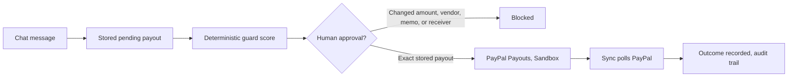
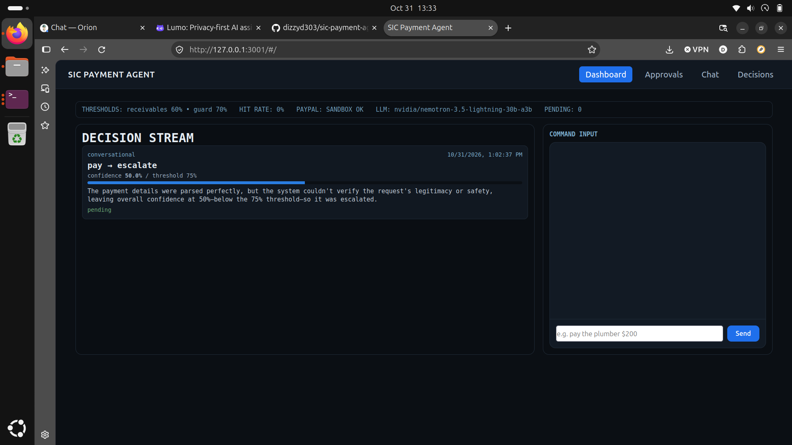
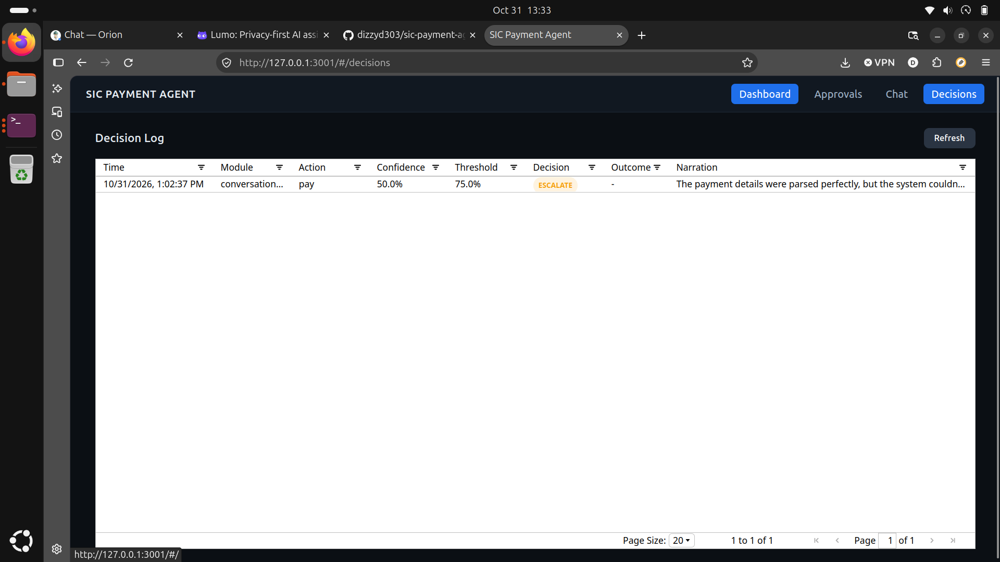
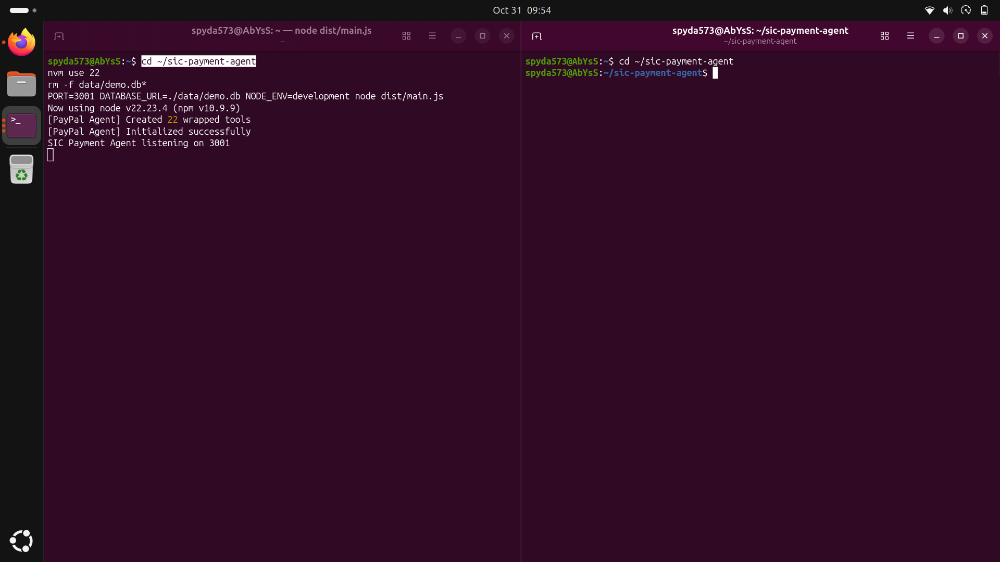
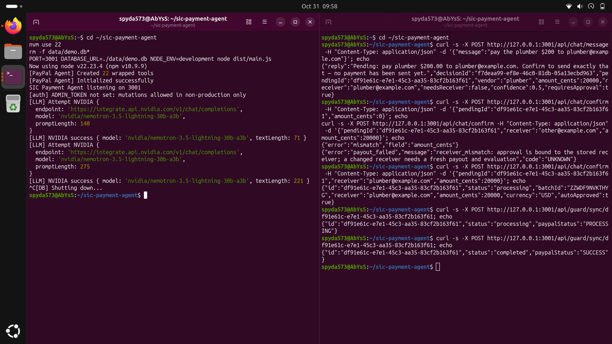

# SIC Payment Agent — Agentic Commerce Platform

**Built for PayPal AI Hackathon 2026** — *Build What's Next with PayPal and AI*

SIC Payment Agent is a payment guard for agentic commerce. Natural language becomes a stored pending payout, scored by a deterministic decision policy, gated for human approval, and executed on PayPal Payouts in Sandbox, with the real batch status retrieved and recorded.

The LLM parses free-form natural language and generates audit-ready narrations that explain deterministic decisions.

## What it does

1. **Chat** — Say "pay the plumber $200" and you get a pending payout. No payment has been sent yet.
2. **Guard** — The payout is evaluated against completed payout history for that vendor: at least 3 completed payouts, compared to their median amount. The result is a confidence score, a threshold, deterministic reasons, and a plain-English narration.
3. **Approval** — Confirm approves only the exact stored payout. A changed amount, vendor, memo, or receiver is blocked. A replayed confirm is blocked.
4. **Execution** — An approved payout is sent through the PayPal Payouts API. Batch acceptance is not success — it just means PayPal accepted the batch.
5. **Sync** — Sync polls PayPal for the batch status and records a success or failure outcome only when PayPal reports a terminal status. Repeated syncs do not duplicate outcomes.
6. **Audit** — Every decision and every outcome is recorded in SQLite, so any payout can be traced back to why it was approved, blocked, or escalated.

## Decision Matrix

Every payout flows through the same steps:

1. **Parse** — The chat LLM parses vendor and amount from natural language. Guard features come from completed payout history in the database.
2. **Score** — Deterministic policy only. Vendor known plus amount within 50% of the median scores higher; unknown vendor or amount far from the median scores lower. The LLM does not score.
3. **Threshold** — Fixed at 0.7 for payment-guard. Below threshold, the payout escalates for human approval.
4. **Route** — Auto-execute or escalate to a human.
5. **Narrate** — The LLM explains the deterministic result in plain English.
6. **Outcomes** — Outcomes are logged for audit. Thresholds do not adapt.

## Quick Start

```bash
# Clone & install
git clone https://github.com/dizzyd303/sic-payment-agent.git
cd sic-payment-agent
pnpm install

# Configure (see JUDGE_RUNBOOK.md for details)
cp .env.example .env
# Edit .env with PayPal Sandbox credentials + LLM keys

# Run
pnpm dev
# → http://localhost:3000
```

## Architecture




```
SIC Payment Agent
UI: Vanilla JS (no React build step)
Server: Express
Decision: Custom deterministic matrix + NVIDIA Nemotron / Ollama for parsing and narration
Data: SQLite (dev) / PostgreSQL (prod)
PayPal: Payouts API via direct client, Sandbox
```

## Project Structure

```
sic-payment-agent/
├── src/
│   ├── main.ts                    # Express app + route mounting
│   ├── services/
│   │   ├── paypal/
│   │   │   └── client.ts          # Direct PayPal API (OAuth, Payouts)
│   │   └── llm/provider.ts        # NVIDIA + Ollama
│   ├── modules/
│   │   ├── payment-guard/         # Confidence-gated payouts
│   │   └── conversational/        # Natural language → payouts
│   ├── core/decision-matrix.ts    # Deterministic scoring engine
│   └── db/init.ts                 # SQLite schema
├── public/
│   ├── index.html                 # Dashboard UI
│   ├── app.js                     # UI logic (vanilla JS)
│   └── styles.css                 # Dark theme
├── demo-run.mjs                   # Script used in the demo video
├── JUDGE_RUNBOOK.md               # Demo guide
└── package.json
```

## API Endpoints

| Module | Endpoints |
|--------|-----------|
| **Guard** | `/api/guard/request`, `/api/guard/approve/:id`, `/api/guard/sync/:id`, `/api/guard/reject/:id`, `/api/guard/evaluate`, `/api/guard/pending` |
| **Chat** | `/api/chat/message`, `/api/chat/confirm` |
| **Decisions** | `/api/decisions` |

## Tests

```bash
pnpm exec tsc --noEmit
pnpm test
# 13 tests passed: payment guard, Postgres SQL helpers, auth
```

## Environment Variables

```bash
# Required
PAYPAL_CLIENT_ID=
PAYPAL_CLIENT_SECRET=
PAYPAL_MODE=sandbox

# LLM (at least one)
NVIDIA_API_KEY=
# OR
OLLAMA_URL=http://localhost:11434  # Local Ollama

# Server
PORT=3000
CONFIDENCE_THRESHOLD=0.7
```

## Demo Video

Demo video: https://youtu.be/V8Li41eCue0 — 1:39, captioned, one flow end-to-end: chat message → pending → blocked changes → approve the exact pending payout → execute on PayPal Sandbox → sync to real status.

## Screenshots

Clean-URL UI run, 10/31/2026, 1:02:37 PM, one $200 plumber payout, escalated, approvals cleared:





Terminal demo run, from the video recording, same guard flow ending in PayPal SUCCESS:





## For judges: Sandbox credentials

No PayPal or LLM credentials are bundled with this repo. To run it yourself, use your own free PayPal developer account for Sandbox credentials, set PAYPAL_CLIENT_ID and PAYPAL_CLIENT_SECRET in .env, and set NVIDIA_API_KEY or run Ollama locally. Without those, PayPal calls fail and no batch id is returned.

## License

MIT — Built for PayPal AI Hackathon 2026

## Team

**D. Young & Co.** — Fulton, Missouri

---

*Every payment deserves a guard, and every guard deserves an audit trail.*
